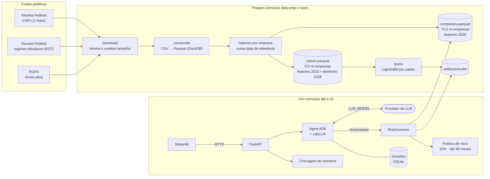
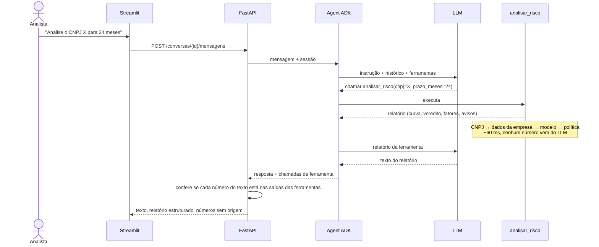

# Risco de Consignado Privado

Sistema de IA que ajuda um analista de crédito a decidir se vale oferecer consignado privado aos
funcionários CLT de uma empresa. O analista informa o CNPJ e conversa com um agent (Google ADK +
LiteLLM). O agent responde com a chance de o **empregador deixar de existir antes do fim do
crédito**, que é o que interrompe o desconto em folha, calculada por um modelo de sobrevivência
treinado com 1,9 milhão de empresas a partir de dados públicos da Receita Federal e da PGFN.

```
Analista: Analise o CNPJ 00.000.000/0001-91 para um consignado de 24 meses.
Agent:    Banco do Brasil · Conceder: risco de 2,0% até o fim do prazo, dentro do limite de 10%.
          Nível de risco baixo. 6 meses: 0,5% · 12: 1,0% · 24: 2,0% · 36: 3,5%. O que mais pesa:
          idade (60 anos), 5.427 filiais, Lucro Real... Avisos: valores fora da faixa do treino...
Analista: E se fossem 48 meses?
Agent:    Não conceder: o prazo passa do máximo da política (36 meses), o horizonte validado...
```

**Sumário:** [Como executar](#como-executar) · [Como usar](#como-usar) ·
[Arquitetura](#arquitetura) · [Dados e recorte](#dados-e-recorte) · [Modelo](#modelo) ·
[Risco aceitável](#critério-de-risco-aceitável) · [Agent](#agent) · [Qualidade](#qualidade) ·
[Estrutura](#estrutura-do-repositório) · [Limitações](#limitações-e-o-que-ficou-de-fora) ·
[Decisões](#decisões-registradas)

## Como executar

**Pré-requisitos:** Docker com Compose v2, cerca de **45 GB livres em disco** (15 GB de dados
brutos, 7 GB processados e até ~20 GB de temporários durante o preparo), **8 GB de memória
disponíveis para o Docker** e acesso à internet.

```bash
cp .env.example .env   # preencha LLM_MODEL e LLM_API_KEY
docker compose up --build
```

O `docker compose up` roda tudo em ordem; cada etapa só começa quando a anterior termina:

| Etapa | Serviço | O que faz | Primeira vez | Depois |
|---|---|---|---|---|
| 1 | `data-prep` | Baixa ~15 GB de dados públicos, converte para Parquet e gera a coorte de treino e a tabela de empresas | ~45 min (≈32 min de download a ~5 MB/s) | ~30 s (só verifica) |
| 2 | `train` | Treina o modelo e grava `artifacts/model/` | ~2 min | segundos (pula se os dados não mudaram) |
| 3 | `api` e `ui` | Sobem a API e a interface | segundos | segundos |

Depois disso: **interface em http://localhost:8501** e **API em http://localhost:8000/docs**.

Todas as etapas são idempotentes: um download interrompido continua de onde parou, e o que já
está pronto é pulado.

### Configuração do LLM

O agent lê três variáveis do `.env` (ver [.env.example](.env.example)):

| Variável | Obrigatória | Exemplo |
|---|---|---|
| `LLM_MODEL` | sim | `gemini/gemini-3.6-flash`, `anthropic/claude-sonnet-5-5`, `openai/gpt-4o` |
| `LLM_API_KEY` | sim | a chave do provedor |
| `LLM_API_BASE` | não | só para provedores com endereço próprio ou proxy (ex.: NVIDIA NIM) |

O modelo precisa ter suporte a chamada de ferramentas. Modelos com raciocínio ("thinking")
funcionam, mas cada resposta fica bem mais lenta: medimos cerca de 2 s por chamada com o Gemini
3.6 Flash e até 2 min com um modelo de raciocínio num endpoint gratuito. Sem LLM configurado, a
interface continua utilizável pela **consulta direta**, que usa o mesmo modelo de risco sem
conversa.

### Problemas comuns

| Sintoma | Causa e solução |
|---|---|
| `data-prep` termina com código 137 | Falta de memória no Docker. Aumente a memória do Docker Desktop ou reduza `DUCKDB_MEMORY_LIMIT` no `.env` (padrão `4GB`); acima do limite, o DuckDB usa disco em vez de memória |
| Download parou no meio | Rode `docker compose up` de novo: os arquivos parciais são retomados |
| A interface diz que o LLM não está configurado | Preencha `LLM_MODEL` e `LLM_API_KEY` e recrie os serviços: `docker compose up -d --force-recreate api ui` (o `.env` só é lido na criação do contêiner) |
| "O provedor de LLM está limitando as requisições" ou erro 503 | Sobrecarga temporária do provedor; o sistema já tenta de novo duas vezes. Espere ou troque de modelo |
| Respostas levam minutos | Modelo de raciocínio ou endpoint lento; prefira um modelo sem raciocínio (ver acima) |
| "O provedor de LLM não aceitou o pedido" | Nome de modelo inválido ou modelo sem suporte a ferramentas |

### Sem Docker (desenvolvimento)

Com [uv](https://docs.astral.sh/uv/):

```bash
make install    # dependências e hooks de pre-commit
make data       # preparo dos dados (~45 min na primeira vez)
uv run python -m consig_risk.modeling.train
make check      # lint + type check + testes, o mesmo que o CI roda
make notebooks  # reexecuta os notebooks, gravando os resultados neles
```

## Como usar

Na interface, converse em linguagem natural. O agent atende os dois pedidos do case e perguntas
de acompanhamento sobre a mesma empresa, sem repetir o CNPJ:

| Pedido | Exemplo | Resposta |
|---|---|---|
| Prazo informado | "Analise o CNPJ 00.000.000/0001-91 para um consignado de 24 meses." | Veredito (conceder ou não) com o motivo |
| Prazo em aberto | "Faça o relatório de risco do CNPJ 00.000.000/0001-91." | Prazo máximo aprovado |
| Acompanhamento | "E se fossem 12 meses?" · "Por que esse prazo?" | Novo veredito ou explicação da política |

O relatório traz: empresa, veredito, nível de risco, **como o risco evolui com o prazo**, **o que
mais pesa** (fatores da empresa com o efeito de cada um), avisos, limitações e a fonte dos dados.
Abaixo de cada resposta, a interface mostra a curva de risco e um selo que confirma que **todos
os números do texto vêm das ferramentas** (ou avisa quais não vêm).

Quando não dá para responder, o agent diz isso em vez de inventar: CNPJ inválido, CNPJ que não
existe na base, empresa não ativa (não conceder), MEI ou órgão público (fora do escopo do
modelo) e pedidos fora do escopo.

Pela API, `GET /empresas/{cnpj}/risco?prazo_meses=24` devolve o mesmo relatório estruturado, sem
LLM.

## Arquitetura



O mesmo código de features (`features/company.py`) gera o dado de treino, com as fotos de 2023, e
o dado das consultas, com a foto de 2026. Por construção, treino e uso calculam as features do
mesmo jeito.

**O caminho de uma pergunta:**



| Componente | Responsabilidade | Código |
|---|---|---|
| Preparo de dados | Baixa as fontes e converte para Parquet tipado | [data/](src/consig_risk/data/) |
| Features | Features por empresa "como eram" numa data; coorte de treino | [features/](src/consig_risk/features/) |
| Modelo | Sobrevivência por partes: treino, avaliação, artefato e explicações SHAP | [modeling/](src/consig_risk/modeling/) |
| Risco | CNPJ (inclusive alfanumérico), política, dados da empresa e relatório | [risk/](src/consig_risk/risk/) |
| Agent | Instruções, ferramentas, sessões e checagem de números | [agent/](src/consig_risk/agent/) |
| API | Conversas, histórico e relatório direto | [api/](src/consig_risk/api/) |
| Interface | Conversa, curva de risco e consulta direta | [ui/](src/consig_risk/ui/) |

A API não guarda estado (a conversa fica no session store do ADK), e cada peça que mudaria num
produto interno está atrás de uma interface ou de uma variável de ambiente: ver
[ADR-0005](docs/adr/0005-caminho-para-escala.md).

## Dados e recorte

| Fonte | Para quê | Por que entra |
|---|---|---|
| **Receita Federal, CNPJ:** empresas, estabelecimentos, Simples, sócios | Evento, duração e a maior parte das features | É o núcleo do problema |
| **Receita Federal, regimes tributários (ECF)** | Lucro Real, Presumido, imune ou sem ECF | Melhora a AUC em ~0,02; tem ano de referência, então não vaza |
| **PGFN, dívida ativa da União** (FGTS, previdenciária, não previdenciária) | Sinais de dificuldade financeira | Melhora a AUC em ~0,015; fotos trimestrais permitem usar só a dívida anterior à origem |

Fontes avaliadas e descartadas, com motivo: CAGED e RAIS (sem CNPJ; medem o vínculo do
funcionário, não a empresa), SCR.data (outro evento), CEIS/CNEP (casos raros) e IBGE (critérios
não comparáveis). Ver [ADR-0002](docs/adr/0002-fontes-de-dados.md).

**O recorte, e como foi escolhido:**

1. **Duas fotos em vez de uma.** As features vêm da foto de **13/05/2023** (a mais antiga
   disponível) e o desfecho da foto de **11/10/2026**: 41 meses de acompanhamento. Numa foto
   única, campos como a opção pelo Simples mudam junto com o fechamento e vazariam o resultado
   (44% das empresas que fecharam saíram do Simples entre as fotos, contra 9% das que
   sobreviveram).
2. **Público-alvo:** empresas **ativas na origem, não MEI, de natureza jurídica empresarial ou
   sem fins lucrativos** (que contratam CLT). Ficam fora MEI (no máximo um empregado),
   administração pública (tem consignado próprio), pessoas físicas com CNPJ e organismos
   internacionais. São **9,5 milhões de empresas**.
3. **Amostra por hash do CNPJ, não por arquivo.** Os 10 arquivos de cada tabela da Receita são
   faixas contíguas de CNPJ, ou seja, coortes por época de abertura; usar alguns arquivos
   enviesaria o modelo. Cada empresa recebe um balde fixo de 0 a 999 pelo hash do CNPJ: treino em
   20% (1,9 mi), validação em 5% e teste em 10%.
4. **As consultas usam a base inteira** (70,5 milhões de empresas na foto de 2026), então qualquer
   CNPJ existente pode ser analisado.

Detalhes, com números e gráficos: [notebooks/01_eda.ipynb](notebooks/01_eda.ipynb).

## Modelo

**O que se modela:** P(a empresa sair da situação cadastral ativa até *t* meses), que é análise de
sobrevivência. Uma única curva por empresa responde a qualquer prazo, ao prazo máximo e ao "e se
fossem 12 meses?", sempre de forma coerente. O evento é sair da situação ativa por qualquer
motivo: baixa, ou inaptidão por omissão de declarações, que é abandono sem baixa formal e só volta
a ser ativa em 8% dos casos.

**Por que exponencial por partes com LightGBM:** a EDA mostrou que as inaptidões chegam em
**lotes anuais** da Receita e que as curvas por idade **se cruzam**. O modelo divide o prazo em
ano 1, ano 2 e ano 3 em diante; em cada período, o risco é uma taxa mensal que depende das
features e da idade da empresa naquele período. Assim ele não aprende o calendário de 2023–2026,
permite efeitos que mudam com o prazo e extrapola avançando a idade.

**Resultados no teste** (954 mil empresas que o treino não viu):

| Horizonte | AUC | Risco previsto | Observado |
|---|---|---|---|
| 12 meses | 0,743 | 6,7% | 6,6% |
| 24 meses | 0,745 | 13,1% | 12,9% |
| 36 meses | 0,730 | 21,1% | 16,4% ¹ |
| 41 meses | 0,751 | 24,0% | 24,3% |

¹ Até o mês 36, a janela observada teve só dois dos três lotes anuais de inaptidão (o de 2025 veio
acumulado em maio de 2026); aos 41 meses, com o calendário completo, o previsto bate com o
observado.

A AUC de ~0,74 é modesta, e é a esperada sem dados de faturamento, folha ou histórico de crédito.
O que o veredito usa é a **probabilidade calibrada**, que confere com o observado nos horizontes
validáveis e por segmento. A separação é melhor no perfil típico de empregador (~0,82 nas médias
e grandes empresas) e fraca em empresas com menos de 3 anos (0,63–0,66).

**Alternativas comparadas** nos mesmos dados: Kaplan-Meier (AUC 0,50), Cox de riscos
proporcionais (0,68, e subestima o risco), GLM de Poisson por partes (0,70) e LightGBM por partes
(**0,74**, o escolhido). Também foram avaliados o modelo sem as fontes complementares e o evento
"só baixada".

**Reprodutibilidade:** splits fixos por hash, treino determinístico e dependências travadas no
`uv.lock`. Duas execuções geram o mesmo arquivo de modelo, e o modelo treinado no Docker faz
previsões idênticas às do treinado no macOS. O agent usa exatamente o artefato gravado por
`python -m consig_risk.modeling.train`.

Detalhes: [notebooks/02_modelagem.ipynb](notebooks/02_modelagem.ipynb) e
[ADR-0003](docs/adr/0003-modelo-de-sobrevivencia.md).

## Critério de risco aceitável

**Regra:** conceder um consignado de *t* meses se a chance de o empregador sair da situação ativa
até *t* for de **no máximo 10%**. O **prazo máximo** é o maior prazo, de 6 em 6 meses até **36**,
que respeita o limite.

**Por que esses valores:** na simulação com as empresas de teste, o limite de 10% aprova 48% dos
empregadores para 24 meses (81% para 12 meses). Entre os aprovados, a saída real em 24 meses foi
de 5,2%, contra 12,9% na média, e 81% das empresas que fecharam teriam sido barradas. O teto de 36
meses é o horizonte validado com desfecho observado, então a política nunca aprova com base em
risco extrapolado.

Antes do modelo, regras simples: empresa não ativa ou em situação especial (falência,
recuperação judicial), não conceder; MEI, órgão público e pessoa física, fora do escopo. O
relatório também avisa quando a empresa tem menos de 3 anos, quando valores estão fora da faixa
do treino e quando o prazo passa de 36 meses.

O limite e o prazo máximo são configuráveis (`RISK_LIMITE_RISCO`, `RISK_PRAZO_MAXIMO_MESES`).
Detalhes: [notebooks/03_politica_de_risco.ipynb](notebooks/03_politica_de_risco.ipynb) e
[ADR-0004](docs/adr/0004-politica-de-risco.md).

## Agent

- **Duas ferramentas:** `analisar_risco(cnpj?, prazo_meses?)`, que cobre os dois tipos de pedido
  e lembra a empresa em análise no estado da sessão, e `explicar_politica()`.
- **O LLM não calcula nada:** ele escolhe a ferramenta e redige o relatório. A instrução exige
  que todo número venha das ferramentas ou da mensagem do analista.
- **Checagem de números:** depois de cada resposta, a API extrai os números do texto (incluindo
  formatos como "2,0%", "5.427" ou "R$ 120 bi") e confere se cada um aparece nas saídas das
  ferramentas. Os que não aparecem são devolvidos e a interface avisa o analista.
- **Erros esperados viram explicação:** CNPJ inválido ou inexistente, prazo inválido, provedor
  de LLM indisponível ou chave recusada.

## Qualidade

- **Testes automatizados:**
  - regras de tempo das features: nada posterior à data de referência entra nelas;
  - conversão dos arquivos reais da Receita (bytes de controle, separadores dentro de aspas);
  - modelo: recupera taxas conhecidas em dados sintéticos;
  - política: testes de propriedade, com curvas aleatórias, verificam que veredito e prazo
    máximo nunca se contradizem;
  - validação de CNPJ, inclusive alfanumérico;
  - checagem de números;
  - fluxo completo do agent com um LLM roteirizado, incluindo sessão, acompanhamento e erros.
- **Ferramentas:** ruff (lint e formatação), mypy em modo estrito, pre-commit e CI no GitHub
  Actions. Rode `make check`.
- **Avaliação do agent com LLM real:** `make test-llm` roda um roteiro de conversas (prazo
  informado, acompanhamento, prazo em aberto, empresa baixada, MEI, CNPJ inválido e inexistente,
  pedido fora do escopo) contra o provedor do `.env` e confere as ferramentas chamadas, os
  argumentos, o veredito e a checagem de números. Fica fora da execução padrão e é pulado sem
  `LLM_API_KEY`.

## Estrutura do repositório

```
src/consig_risk/
  config.py       configuração por variáveis de ambiente
  duck.py         conexão DuckDB do pipeline (temporários no volume de dados)
  data/           download das fontes e conversão para Parquet
  features/       features por empresa numa data de referência; coorte de treino
  modeling/       modelo de sobrevivência: dados, candidatos, métricas, treino e artefato
  risk/           CNPJ, política de risco, dados da empresa e relatório
  agent/          agent ADK: instruções, ferramentas, sessões e checagem de números
  api/            API FastAPI
  ui/             interface Streamlit
tests/            testes automatizados (unit/) e avaliação com LLM real (llm/)
notebooks/        01 EDA · 02 modelagem e avaliação · 03 política de risco (executados)
docs/adr/         decisões de arquitetura, com contexto e alternativas
docker/           imagem única usada por todos os serviços
data/             dados baixados e processados (gerado; não versionado)
artifacts/        modelo treinado (gerado; não versionado)
```

## Limitações e o que ficou de fora

**Do problema e dos dados:**
- **Mede-se o fim do empregador, não a inadimplência.** A demissão do funcionário e a capacidade
  de pagamento não são modeladas; dados de vínculo (CAGED, RAIS) não têm CNPJ público.
- **Não há dados de faturamento, folha ou número de funcionários.** "Empregador" é aproximado
  pela natureza jurídica e pela exclusão do MEI; porte, filiais e regime tributário funcionam
  como indicadores de tamanho.
- **Duas fotos não mostram o que acontece entre elas:** uma empresa que ficou inapta e foi
  reativada aparece como sobrevivente.
- **A data da inaptidão é administrativa** (lotes da Receita), não a data em que a empresa parou.

**Do modelo:**
- **Risco acima de 36 meses é extrapolado,** sem validação direta; por isso a política não aprova
  além desse prazo.
- **O modelo distingue pouco entre empresas com menos de 3 anos.**
- **Valores muito acima da faixa do treino** (capital de centenas de bilhões, milhares de
  filiais) são tratados como o maior valor visto; o relatório avisa.
- **O limite de 10% foi escolhido por análise de dados,** sem dados de rentabilidade do produto.
  Com taxa, custo de captação e recuperação reais, ele deveria ser recalibrado pela perda esperada
  ponderada pelo saldo devedor.

**Do agent:**
- **A checagem confere números, não o sentido do texto.** Uma paráfrase errada de uma
  justificativa não é detectada.
- **A latência depende do provedor de LLM:** de segundos a minutos (ver
  [Configuração do LLM](#configuração-do-llm)).

**Ficou de fora, por estar além do tamanho do problema:** autenticação, auditoria e
observabilidade de produção, atualização mensal automática dos dados e monitoramento de
calibração, cache de relatórios e streaming de respostas. O caminho para cada um está no
[ADR-0005](docs/adr/0005-caminho-para-escala.md).

## Decisões registradas

| ADR | Decisão |
|---|---|
| [0001](docs/adr/0001-stack-e-estrutura-do-repositorio.md) | Stack de engenharia e estrutura do repositório |
| [0002](docs/adr/0002-fontes-de-dados.md) | Fontes de dados e desenho temporal (duas fotos) |
| [0003](docs/adr/0003-modelo-de-sobrevivencia.md) | Modelo de sobrevivência exponencial por partes com LightGBM |
| [0004](docs/adr/0004-politica-de-risco.md) | Política de risco aceitável |
| [0005](docs/adr/0005-caminho-para-escala.md) | Como o sistema escala para uso interno |

## Licença

Todos os direitos reservados. O repositório está visível apenas para avaliação no processo
seletivo; qualquer outro uso exige autorização do autor. Ver [LICENSE](LICENSE).
